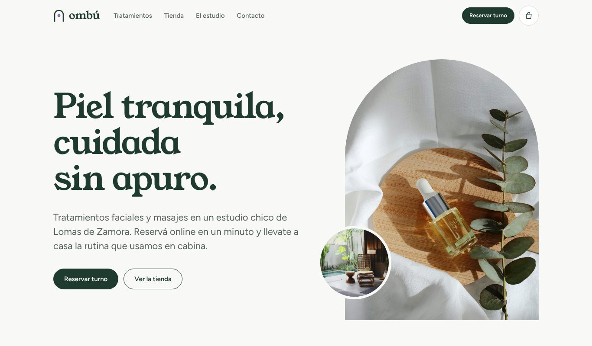
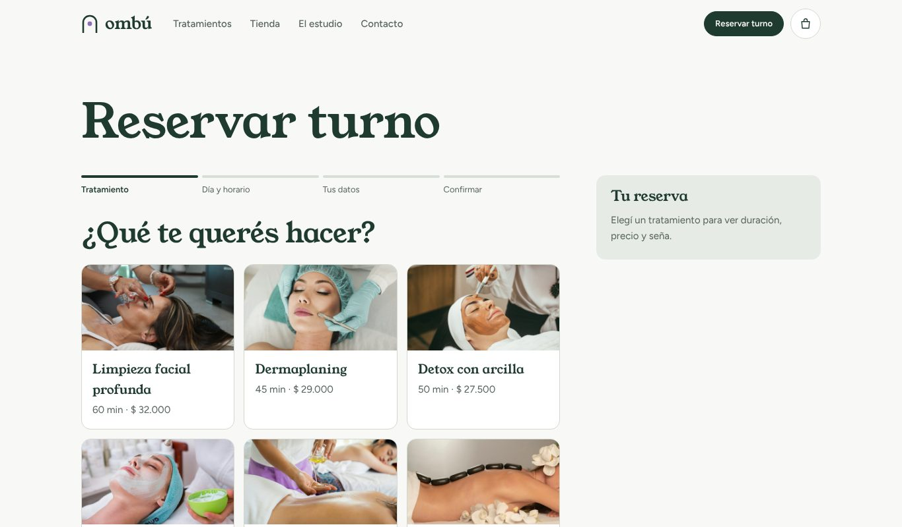
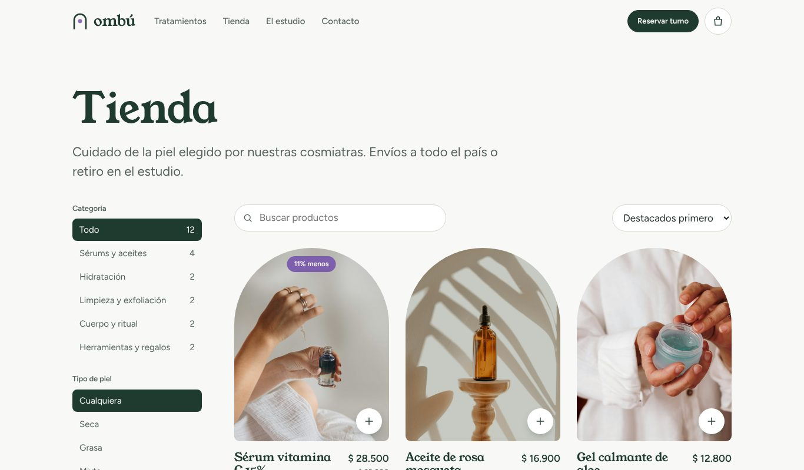
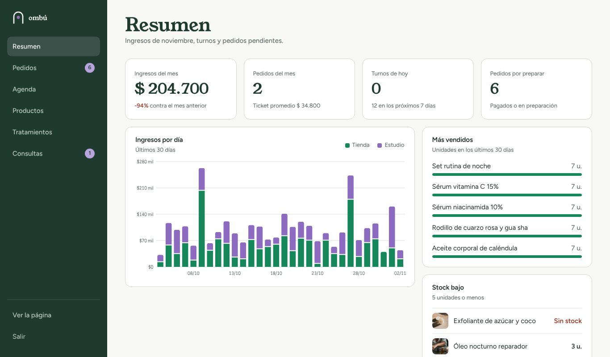

# Ombú: turnos y tienda online

Sistema web full stack para un estudio de estética: los clientes reservan turnos con seña y compran productos online, y el dueño maneja agenda, pedidos, stock e ingresos desde un panel. Ombú es una marca ficticia; el proyecto usa la misma arquitectura que desarrollé para un cliente real.

**Demo online:** https://ombu-zf8g.onrender.com
**Panel:** https://ombu-zf8g.onrender.com/panel (usuario `admin`, contraseña `ombu2026`)

> Está en un plan gratuito: si nadie la usó en un rato, la primera carga tarda unos segundos. Los pagos funcionan en modo demo (se simula la respuesta de Mercado Pago).



| Reserva de turno | Tienda | Panel |
|---|---|---|
|  |  |  |

## Qué hace

**Para el cliente**
- Reserva de turnos en 4 pasos: tratamiento, día y horario con profesional, datos y pago de la seña (30%).
- Tienda con filtros, búsqueda, detalle de producto y carrito.
- Checkout con envío o retiro en el estudio, y seguimiento del pedido.
- Link para ver el estado del turno y cancelarlo, sin crear cuenta.

**Para el dueño (panel con login)**
- Resumen del mes: ingresos, gráfico de los últimos 30 días (tienda y estudio), más vendidos y stock bajo.
- Pedidos por estado: pagado, preparando, enviado, entregado o cancelado.
- Agenda semanal: cobrar el resto, marcar ausente o cancelar.
- ABM de productos, precios y duración de tratamientos, y consultas del formulario de contacto.

## Stack

- **Backend:** C# con ASP.NET Core Web API (.NET 10)
- **Datos:** PostgreSQL con ADO.NET (Npgsql) y SQL escrito a mano
- **Frontend:** React con TypeScript (Vite), CSS propio y mobile first
- **Seguridad:** JWT para el panel y contraseñas con BCrypt
- **Pagos:** Mercado Pago Checkout Pro con webhook
- **Deploy:** Docker en Render, base en Neon

## Arquitectura

Solución en capas con POO, donde cada capa solo usa la de abajo:

```
ombu.client      React + TypeScript (sitio público y panel)
Ombu.Server      Web API: controladores REST, JWT, sirve el frontend compilado
Ombu.Negocio     Reglas de negocio: turnos, pedidos, stock, pagos
Ombu.Datos       Acceso a datos con Npgsql y SQL parametrizado
Ombu.Entidades   Clases del dominio y enums
```

En producción es una sola aplicación: el `Dockerfile` compila el frontend y lo sirve desde el mismo servidor .NET.

**Modelo de datos (12 tablas):** `categoria`, `producto`, `tratamiento`, `profesional`, `horario_atencion`, `cliente`, `turno`, `pedido`, `pedido_item`, `pago`, `consulta`, `usuario`.

## Decisiones técnicas

- **Los precios salen siempre de la base**, nunca de lo que manda el navegador, para que nadie pueda pagar menos modificando la página.
- **Cada pago se verifica consultando a Mercado Pago** antes de confirmar un turno o un pedido, y se procesa una sola vez aunque lleguen juntos el webhook y la vuelta del cliente.
- **El stock se descuenta al crear el pedido** y se devuelve solo si no se paga en 30 minutos o si se cancela.
- **El horario de un turno queda reservado 15 minutos** mientras el cliente paga la seña; si no paga, se libera.
- **Hora de Argentina en todo el sistema**, calculada desde UTC: el servidor está en otra zona horaria.
- **Modo demo:** sin token de Mercado Pago, una pantalla simula el pago aprobado o rechazado, así el flujo completo se puede probar sin cobrar.

## Cómo correrlo en local

Requisitos: .NET 10 SDK, Node 22 y PostgreSQL.

1. Crear la base `ombu` y correr `BaseDeDatos/ombu.sql` (crea las tablas y carga datos de ejemplo con fechas relativas a hoy).
2. Configurar la conexión en los secretos de usuario de `Ombu.Server`:
   ```json
   { "ConnectionStrings": { "Ombu": "Host=localhost;Port=5432;Database=ombu;Username=postgres;Password=TU_CLAVE" } }
   ```
3. En `ombu.client`, correr `npm install`.
4. Abrir `Ombu.sln` en Visual Studio y ejecutar `Ombu.Server`, o desde la consola:
   ```
   dotnet run --project Ombu.Server
   cd ombu.client && npm run dev
   ```
   y entrar a `http://localhost:5173`.

## Autor

**Damián Bacque**, analista funcional y desarrollador full stack jr.
[Portfolio](https://damianbacque.netlify.app) · [LinkedIn](https://www.linkedin.com/in/damian-bacque/) · damian.bacque235@gmail.com
